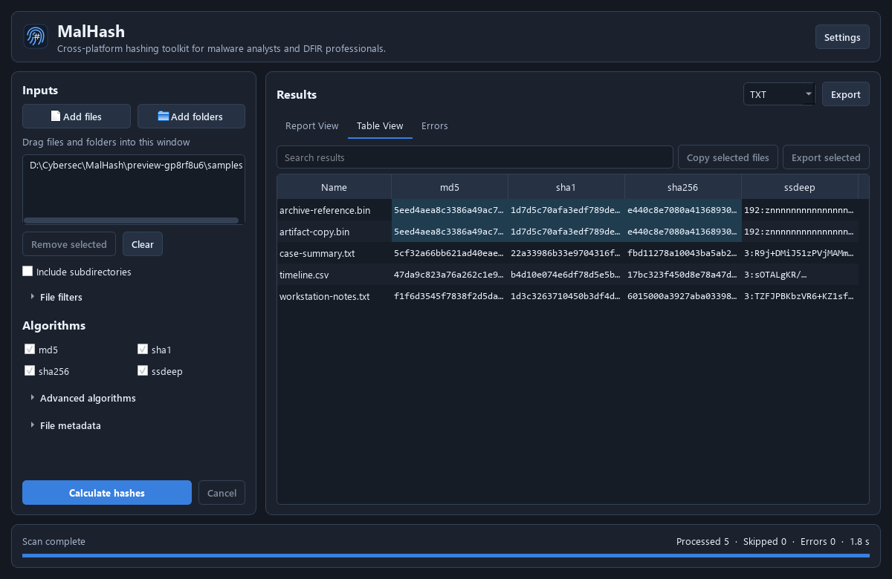

# MalHash

Herramienta multiplataforma de cálculo de hashes para el análisis de malware, la informática forense y la respuesta a incidentes.

[English](README.md) · [Русский](README.ru.md)

MalHash calcula hashes de archivos locales y genera fichas de análisis con metadatos opcionales. La aplicación de escritorio y la CLI comparten un núcleo que funciona sin conexión. La CLI se puede instalar en equipos sin entorno gráfico.



## Funciones

- Procesamiento de archivos y carpetas con filtros por extensión, patrones glob, exclusiones de directorios y tamaño máximo. La recursión es opcional.
- Lectura por bloques, concurrencia limitada, errores por archivo y cancelación con conservación de los resultados completados.
- Fichas TXT, CSV, TSV, JSON, JSON Lines, Markdown y listas de hashes de un solo algoritmo.
- Interfaz e informes de texto en inglés, ruso y español. Las claves y los estados de los formatos estructurados son estables.
- Búsqueda, ordenación, selección y exportación de filas con la aplicación gráfica. Copia de hashes y fichas, y resaltado de coincidencias criptográficas.

## Algoritmos y plataformas

`md5`, `sha1`, `sha256` y `ssdeep` están activos de forma predeterminada. También se incluyen `sha512`, `sha3-256`, `sha3-512`, `blake2b`, `blake2s`, `crc32` y `authenticode-sha256`. El extra `algorithms` instala `blake3`, `tlsh` e `imphash`. TLSH requiere longitud y diversidad de bytes suficientes. IMPHASH y Authenticode SHA-256 se aplican a archivos PE. El hash Authenticode no verifica el certificado de firma.

La instalación desde el código fuente requiere CPython 3.11 o posterior. Las compilaciones nativas están destinadas a Windows 10/11 x64, Linux x64/ARM64 y macOS ARM64/x64. Cada sistema tiene requisitos específicos de bibliotecas y versión. [Guía de compilación en inglés](docs/BUILDING.md)

## Instalación y uso

```bash
python -m pip install .
python -m pip install '.[gui]'
python -m pip install '.[all]'
```

El primer comando instala la CLI y el núcleo. El segundo añade la aplicación gráfica. El tercero incorpora también los algoritmos adicionales. Para instalar sin conexión, prepara previamente un directorio de ruedas compatible con el equipo de destino. [Instrucciones en inglés](README.md#installation)

```bash
malhash sample.exe
malhash ./samples -r --lang es
malhash ./samples -r --include '*.exe' --exclude-dir quarantine --max-size 2GiB
malhash ./samples -r --format jsonl -o results.jsonl --workers 4
malhash ./samples -r --algorithms sha256 --format hash-only
malhash ./samples -r --relative-paths --report-lang es -o report.txt
malhash-gui
```

Ejecuta `malhash --lang es --help` para ver todas las opciones. Los resultados se escriben en stdout y los diagnósticos en stderr. El código `0` indica éxito, `1` indica fallos parciales, `2` indica argumentos inválidos o un error crítico y `130` indica interrupción del usuario.

En la GUI, añade archivos o directorios con los botones o arrastrándolos a la ventana. Selecciona los algoritmos y pulsa **Calcular hashes**. Las pestañas **Informe**, **Tabla** y **Errores** muestran fichas, resultados y diagnósticos, respectivamente. Usa los menús contextuales de las celdas, filas o encabezados para copiar. En los ajustes puedes elegir el tema, los idiomas de la interfaz y el informe, y activar el historial local. De forma predeterminada, solo se guardan las preferencias.

Ficha de ejemplo para `sample.txt`, cuyo contenido es exactamente `abc`.

```text
Nombre: sample.txt
md5: 900150983cd24fb0d6963f7d28e17f72
sha1: a9993e364706816aba3e25717850c26c9cd0d89d
sha256: ba7816bf8f01cfea414140de5dae2223b00361a396177a9cb410ff61f20015ad
ssdeep: 3:uG:uG
```

## API de Python

```python
from malhash.core import hash_file

result = hash_file("sample.exe", algorithms=("sha256",), metadata=("size",))
if result.status == "ok":
    print(result.hashes["sha256"].value)
```

Para procesar directorios con un número limitado de trabajadores, usa `process_paths`. [Ejemplo en inglés](README.md#python-api)

## Seguridad y limitaciones

MalHash abre los archivos en modo de lectura y funciona sin ejecutar muestras ni enviar datos a servicios externos. La lectura puede actualizar `atime`. Trabaja con una imagen forense o un montaje de solo lectura para preservar evidencia. El recorrido omite enlaces simbólicos, puntos de unión y puntos de reanálisis. Las comprobaciones de cambios se basan en descriptores y metadatos del sistema de archivos.

La detección de tipos usa un conjunto limitado de firmas. IMPHASH está limitado a 32 MiB. Para grandes inventarios, usa la CLI con JSONL en flujo. [Política de seguridad en inglés](SECURITY.md)

## Compilación y licencia

Ejecuta `python -m pytest`, `python -m ruff check .` y `python -m ruff format --check .` para comprobar el proyecto. Para una compilación nativa, ejecuta `python scripts/build_release.py` en un entorno con `.[all,dev,build]`. El código y los recursos gráficos de MalHash se distribuyen bajo la licencia MIT. Las dependencias conservan sus propias licencias. [Compilación](docs/BUILDING.md) · [Avisos de terceros](docs/THIRD_PARTY_NOTICES.md) · [Contribuciones](CONTRIBUTING.md) · [Licencia](LICENSE)
