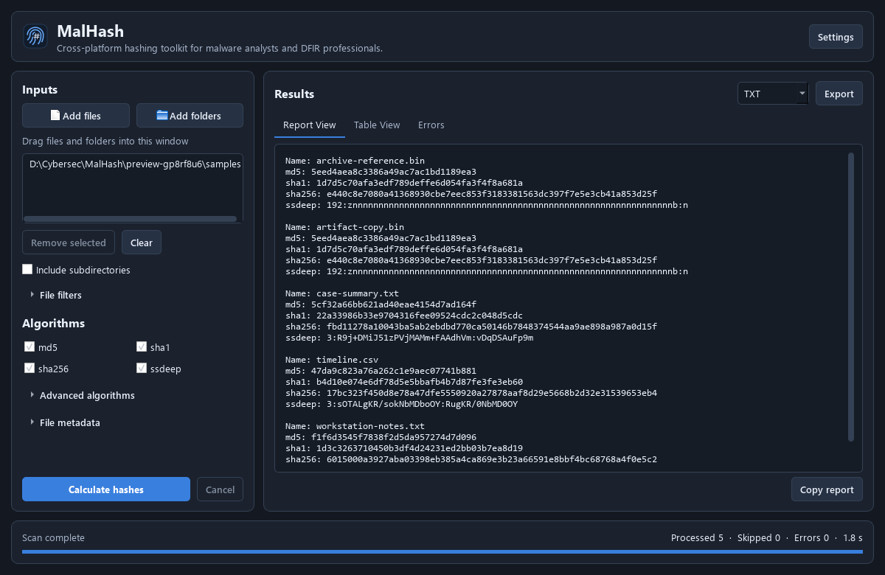
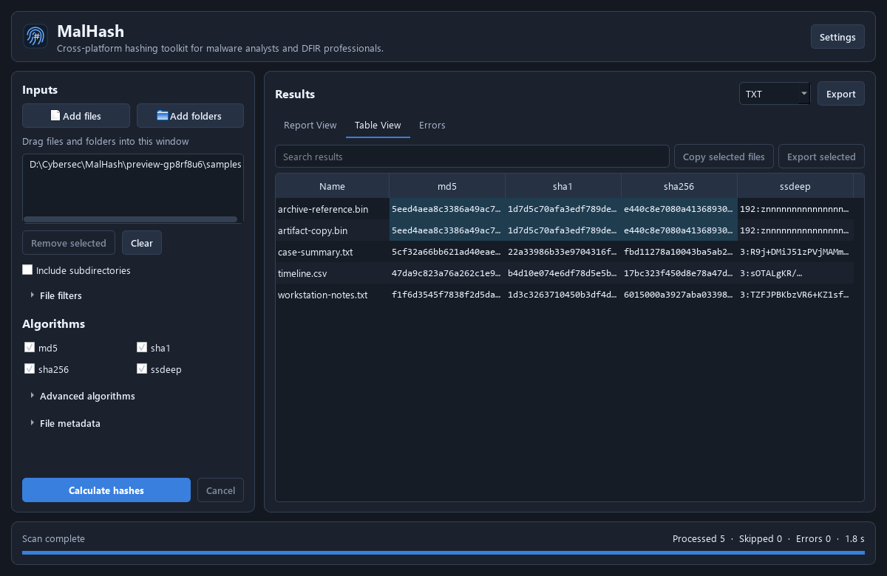

<p align="center">
  
</p>

<h1 align="center">MalHash</h1>

<p align="center">Cross-platform hashing toolkit for malware analysts and DFIR professionals.</p>

<p align="center">
  <a href="https://github.com/GudiniMalware/MalHash/releases"><strong>Download MalHash</strong></a>
</p>

<p align="center">
  <a href="LICENSE"></a>
  <a href="https://www.python.org/downloads/"></a>
  <a href="SECURITY.md"></a>
</p>

<p align="center">
  <a href="#quick-start">Quick start</a> ·
  <a href="#supported-algorithms">Algorithms</a> ·
  <a href="#python-api">Python API</a> ·
  <a href="#security-and-limitations">Security</a> ·
  <a href="README.ru.md">Русский</a> ·
  <a href="README.es.md">Español</a>
</p>

MalHash turns local files and directories into copy-ready malware analysis cards and structured hash reports. The PySide6 desktop app and the headless CLI share one offline core. Choose English, Russian or Spanish separately for the interface and the text report.

[](assets/screenshots/report.png)

<details>
<summary>See the searchable Table View</summary>



</details>

## Quick start

### Windows desktop

1. Download the portable ZIP, choose **Extract All**, then double-click **MalHash.exe**. Python and Qt are included. [Download the portable ZIP](https://github.com/GudiniMalware/MalHash/releases/latest/download/MalHash-Windows-x64-Portable.zip)
2. Drag a file or folder into the window and click **Calculate hashes**.
3. Copy the report or export the results.

For a Start menu shortcut, extract the installer ZIP and run **MalHash-Setup.exe**. It installs for your Windows account and appears in **Settings → Apps**. [Download the installer ZIP](https://github.com/GudiniMalware/MalHash/releases/latest/download/MalHash-Windows-x64-Setup.zip)

### From source

Run these commands from the MalHash source directory.

| Install | Command |
| --- | --- |
| Headless CLI and Python API | `python -m pip install .` |
| Desktop app and CLI | `python -m pip install ".[gui]"` |
| CLI with optional algorithms | `python -m pip install ".[algorithms]"` |
| Desktop app with all algorithms | `python -m pip install ".[all]"` |

```bash
malhash sample.bin
malhash ./samples -r --algorithms sha256,ssdeep --format jsonl -o hashes.jsonl
malhash-gui
```

Run `malhash-gui` after installing the `gui` or `all` extra. Native archives include the Python runtime. For an offline source install, prepare a wheelhouse for the target OS and Python version, then run `python -m pip install --no-index --find-links /path/to/wheelhouse ".[all]"`.

## Choose your workflow

| Desktop | Headless CLI |
| --- | --- |
| Add files and folders by dragging them into the window. Follow progress and file errors while a scan runs in the background. | Scan files or directory trees with recursion, extension filters, include and exclude patterns, and size limits. |
| Search and sort results, highlight matching digests, copy a hash or an entire column, and export selected rows. | Stream results to stdout or save TXT cards, CSV, TSV, JSON, JSONL, Markdown or a hash-only list. |
| Set the theme, interface language and report language independently. Enable local history to retain paths and hashes across sessions. | Set the worker count, pipe results downstream, and keep completed records when cancellation can safely finish the report. |

## Supported algorithms

| Algorithms | Availability |
| --- | --- |
| `md5`, `sha1`, `sha256`, `ssdeep` | Included and enabled by default |
| `sha512`, `sha3-256`, `sha3-512`, `blake2b`, `blake2s`, `crc32` | Included, opt in |
| `blake3`, `tlsh`, `imphash` | Install the `algorithms` extra, then opt in |
| `authenticode-sha256` | Included, opt in for Windows PE files |

`imphash` requires a PE import table. Authenticode SHA-256 calculates the PE content digest and does not validate signing certificates. TLSH requires sufficient length and byte diversity. Use SHA-256 for file identity. MD5, SHA-1, CRC32 and fuzzy digests remain useful for compatibility and triage.

The optional metadata fields are byte size, relative and absolute paths, MIME type, type by signature, the first 16 bytes in hexadecimal, Shannon entropy in bits per byte and UTC modification time.

## Supported platforms

Source installs use CPython 3.11 or later. The desktop app uses Qt for Python. Native release targets are Windows 10/11 x64, Linux x64/ARM64 and macOS ARM64/x64. The build guide covers minimum system requirements, the Windows executable names, macOS Gatekeeper and Linux runtime libraries. [Building and releasing](docs/BUILDING.md)

## CLI

```bash
malhash sample.bin
malhash ./samples
malhash ./samples -r --lang es
malhash ./samples -r --include '*.exe' --include '*.dll' --exclude-dir quarantine
malhash ./samples -r --extension exe --max-size 4GiB --workers 4 --verbose
malhash ./samples -r --algorithms md5,sha256,ssdeep,imphash,tlsh --format json -o results.json
malhash ./samples -r --metadata size,entropy,modified_at --format jsonl -o results.jsonl
malhash ./samples -r --algorithms sha256 --format hash-only | sort
malhash ./samples -r --relative-paths --lang en --report-lang ru -o report.txt
```

Run `malhash --help` or `malhash --lang ru --help` for all flags. Paths are relative to each supplied input directory when `--relative-paths` is set. Results go to stdout by default. Progress and diagnostics go to stderr. Use `--quiet` to suppress progress and warnings or `--no-color` to disable diagnostic colors. An interrupted invocation retains completed rows while finishing the report when possible.

| Exit code | Meaning |
| --- | --- |
| `0` | Completed |
| `1` | Completed with file-level errors |
| `2` | Invalid usage or critical startup/output failure |
| `130` | Interrupted by the user |

## Desktop app

Launch `malhash-gui` or open the platform bundle. Add files or directories with the toolbar or by dragging them onto the window. Choose the algorithms and filters, then click **Calculate hashes**. Use **Cancel** to stop processing. **Report** shows copy-ready cards, **Table** supports searching, sorting, clipboard actions and exporting selected rows, and **Errors** lists file-level issues.

In **Settings**, choose the appearance, interface language, report language, filename display and worker count. The same dialog lets you opt into remembering paths and hash results.

## Output examples

The default card for `sample.txt` containing exactly the three bytes `abc` is shown below. Multi-file TXT has one blank line between cards.

```text
Name: sample.txt
md5: 900150983cd24fb0d6963f7d28e17f72
sha1: a9993e364706816aba3e25717850c26c9cd0d89d
sha256: ba7816bf8f01cfea414140de5dae2223b00361a396177a9cb410ff61f20015ad
ssdeep: 3:uG:uG
```

With `--format jsonl --algorithms sha256 --metadata size`, the same file produces one JSON object per line.

```json
{"name": "sample.txt", "hashes": {"sha256": {"value": "ba7816bf8f01cfea414140de5dae2223b00361a396177a9cb410ff61f20015ad", "status": "ok"}}, "metadata": {"size": 3}}
```

Structured hashes report `ok`, `not_applicable`, `unavailable` or `error`. Uncomputed values are null or empty according to the format. Hash-only writes successful values for exactly one requested algorithm. CSV and TSV prefix formula-like filename and metadata cells with an apostrophe for spreadsheet use. JSON preserves those values without spreadsheet escaping.

## Python API

```python
from malhash.core import ScanOptions, hash_file, process_paths
from malhash.exporters import write_report

result = hash_file("sample.bin", algorithms=("sha256",), metadata=("size",))
if result.status == "ok":
    digest = result.hashes["sha256"]
    if digest.status == "ok":
        print(digest.value)

results = process_paths(
    ["samples"],
    algorithms=("sha256", "ssdeep"),
    scan_options=ScanOptions(recursive=True, extensions=("exe", "dll")),
    workers=4,
)
with open("results.jsonl", "w", encoding="utf-8", newline="") as stream:
    write_report(results, stream, format="jsonl", algorithms=("sha256", "ssdeep"))
```

## Security and limitations

- MalHash reads file data and metadata. It has no sample execution, DLL loading, preview, archive extraction or network submission features. File evidence stays on the local system.
- Read access can update filesystem access times (`atime`). Use a validated read-only mount or a forensic image when processing evidence. Keep reports outside the evidence tree.
- Directory discovery rejects symbolic links, junctions and reparse points in any path component. On macOS, use the physical path when a system alias is present, for example `/private/tmp` in place of `/tmp`. The core checks open descriptors and file metadata for replacement or modifications. A hostile process with write access or a filesystem with weak identity or timestamp guarantees can still interfere. See the security policy for details. [Security policy](SECURITY.md)
- Signature classification uses a fixed set of formats. MIME may fall back to a filename extension. IMPHASH is limited to 32 MiB to bound PE parser input. Authenticode skips malformed or unsupported PE layouts. The SSDEEP backend accelerates verified repeating patterns. General data follows the pure-Python path, which can reduce throughput on large files. Unrepresentable SSDEEP block sizes return `not_applicable`.
- Desktop results and report text are retained in memory for display and selection. For very large inventories, run the CLI with streaming JSONL and a worker count appropriate for your storage device.

## Building and contributing

Install `.[all,dev,build]`, run `python -m pytest`, `python -m ruff check .` and `python -m ruff format --check .`, then run `python scripts/build_release.py` for a native archive. Platform details, dependency notices and contributor guidance are available in the project documentation. [Build guide](docs/BUILDING.md) · [Third-party notices](docs/THIRD_PARTY_NOTICES.md) · [Contributing](CONTRIBUTING.md)

## License

MalHash code and original artwork are distributed under the MIT License. Dependencies retain their own terms. [License](LICENSE) · [Third-party notices](docs/THIRD_PARTY_NOTICES.md)
