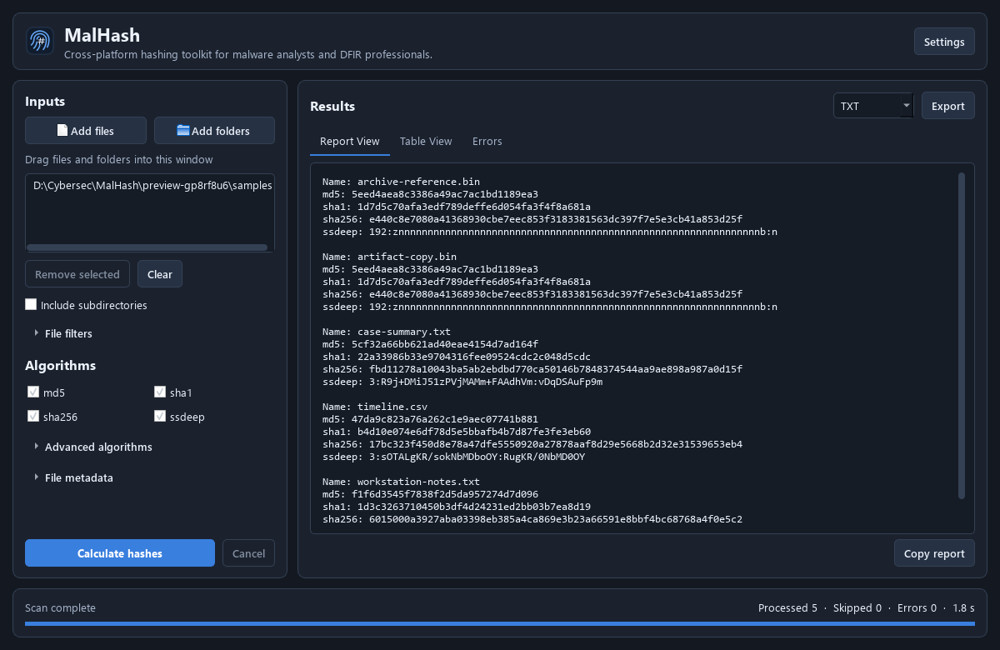

# MalHash

Кроссплатформенная утилита хэширования для аналитиков ВПО и специалистов по цифровой криминалистике и реагированию на инциденты.

[English](README.md) · [Español](README.es.md)

MalHash хэширует локальные файлы, формирует карточки анализа и по запросу включает метаданные. CLI и настольное приложение используют общее ядро и работают офлайн. Для CLI графические библиотеки не требуются.



## Возможности

- Обработка файлов и каталогов с фильтрацией по расширению, glob-шаблонам, исключаемым каталогам и размеру. Рекурсивный режим включается отдельно.
- Потоковое чтение, ограниченное число рабочих потоков, обработка ошибок отдельных файлов и отмена с сохранением готовых результатов.
- Карточки TXT, CSV, TSV, JSON, JSON Lines, Markdown и списки хэшей одного алгоритма.
- Английский, русский и испанский для интерфейса и текстового отчёта. Имена полей и статусы структурированных отчётов всегда остаются стабильными.
- Сортировка, поиск, выделение и экспорт строк в GUI, копирование хэшей и карточек, подсветка одинаковых криптографических хэшей.

## Алгоритмы и платформы

По умолчанию включены `md5`, `sha1`, `sha256` и `ssdeep`. Дополнительно доступны `sha512`, `sha3-256`, `sha3-512`, `blake2b`, `blake2s`, `crc32` и `authenticode-sha256`. Дополнение `algorithms` устанавливает `blake3`, `tlsh` и `imphash`. Для TLSH нужны достаточная длина и разнообразие байтов. IMPHASH и Authenticode SHA-256 применимы к PE-файлам. Расчёт Authenticode SHA-256 не проверяет сертификат подписи.

Для установки из исходников требуется CPython 3.11 или новее. Целевые бинарные сборки предназначены для Windows 10/11 x64, Linux x64/ARM64 и macOS ARM64/x64. Совместимость зависит от версии ОС и системных библиотек. [Руководство по сборке на английском](docs/BUILDING.md)

## Установка и запуск

```bash
python -m pip install .
python -m pip install '.[gui]'
python -m pip install '.[all]'
```

Первая команда устанавливает ядро и CLI, вторая добавляет GUI, третья также добавляет дополнительные алгоритмы. Для офлайн-установки заранее подготовьте каталог с колёсами для целевой платформы. [Инструкция на английском](README.md#installation)

```bash
malhash sample.exe
malhash ./samples -r --lang ru
malhash ./samples -r --include '*.exe' --exclude-dir quarantine --max-size 2GiB
malhash ./samples -r --format jsonl -o results.jsonl --workers 4
malhash ./samples -r --algorithms sha256 --format hash-only
malhash ./samples -r --relative-paths --report-lang ru -o report.txt
malhash-gui
```

Параметры CLI доступны через `malhash --lang ru --help`. CLI пишет результаты в stdout, диагностику в stderr. Код `0` означает успешное завершение, `1` — ошибки отдельных файлов, `2` — неверные аргументы или критическую ошибку, `130` — прерывание пользователем.

В GUI добавьте файлы и каталоги кнопками или перетаскиванием. Выберите нужные алгоритмы и нажмите **Рассчитать хэши**. Вкладки **Отчёт**, **Таблица** и **Ошибки** показывают карточки, строки результатов и диагностику. Правый клик по хэшу, строке или заголовку столбца открывает команды копирования. В настройках можно включить светлую тему, независимо выбрать язык интерфейса и отчёта, а также разрешить хранение истории. По умолчанию сохраняются только настройки.

Карточка для файла `sample.txt` из трёх байтов `abc` выглядит так.

```text
Имя: sample.txt
md5: 900150983cd24fb0d6963f7d28e17f72
sha1: a9993e364706816aba3e25717850c26c9cd0d89d
sha256: ba7816bf8f01cfea414140de5dae2223b00361a396177a9cb410ff61f20015ad
ssdeep: 3:uG:uG
```

## Python API

```python
from malhash.core import hash_file

result = hash_file("sample.exe", algorithms=("sha256",), metadata=("size",))
if result.status == "ok":
    print(result.hashes["sha256"].value)
```

Для обхода каталогов с ограниченной параллельностью используйте `process_paths`. [Пример на английском](README.md#python-api)

## Безопасность и ограничения

MalHash открывает файлы на чтение, не запускает их и не отправляет данные по сети. Чтение может менять время последнего доступа `atime`. Для работы с доказательствами используйте образ или проверенное монтирование только для чтения. Обход пропускает символические ссылки, junction и reparse points. Проверки изменений и подмены используют дескрипторы и метаданные файловой системы.

Тип файла определяется по ограниченному набору сигнатур. IMPHASH ограничен файлами размером до 32 МиБ. Для больших наборов файлов используйте CLI с потоковым JSONL. [Политика безопасности на английском](SECURITY.md)

## Сборка и лицензия

Проверки запускаются через `python -m pytest`, `python -m ruff check .` и `python -m ruff format --check .`. Для нативной сборки выполните `python scripts/build_release.py` в среде с `.[all,dev,build]`. Код MalHash и графические материалы доступны по лицензии MIT. Применяются отдельные условия распространения зависимостей. [Сборка](docs/BUILDING.md) · [Сторонние компоненты](docs/THIRD_PARTY_NOTICES.md) · [Вклад в проект](CONTRIBUTING.md) · [Лицензия](LICENSE)
